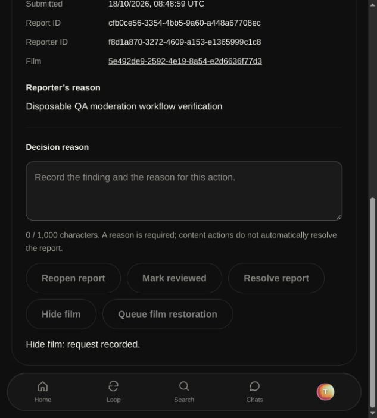

# Development readiness verification — 2026-10-18

Owner: founder + Codex. Branch: `codex/production-readiness`. This records development
and local production-mode tests, not a hosted staging or production release.

## Automated checks

- `pnpm test`: 31 passed (4 shared contracts, 10 media inspection, 17 web tests).
- `pnpm lint`, `pnpm check-types`, `pnpm build`: passed after final web edits.
- Deno Edge checks passed; `deno task --config supabase/functions/deno.json test`:
  28 passed, including bounded cleanup/retry and invalid snapshot/path cases.
- All nine transactional SQL suites passed; fixtures were rolled back. Both lifecycle
  suites were additionally run with the private RPC wrapper migration before apply.
- `node scripts/check-web-security.mjs` against a local production server: guest home,
  unique request nonces matching every SSR script, no production `unsafe-eval`,
  nosniff/frame protection, cross-origin/unsigned/oversized deletion denials and
  unsigned webhook denial passed.
- A scan of all 58 generated browser artifacts found none of the configured server
  Clerk/service-role/R2/cache-purge secrets. Secret values were never displayed.

## Live disposable journey

The founder approved one disposable development Clerk account, at most two films,
six generated assets and one synthetic conversation, with scoped permanent cleanup.
Actual use: one account, two films sharing three generated assets, one conversation.
Exact IDs were recorded in a private `/tmp` manifest; no personal media was uploaded.

1. Created the test identity/profile, saved three mood choices and multi-role details.
2. Reserved, uploaded directly to private R2 and server-verified a generated MP4 film,
   hook and WebP poster. Published natively, added a credit, confirmed guest film reads
   and 256-byte CDN `206 Partial Content` delivery.
3. Submitted a disposable report, used founder report/hide controls with a recorded
   reason, then ran authenticated cleanup only after a fail-closed audit found zero
   unrelated jobs, expired orphans or duplicate sources. All three previously public
   asset URLs returned `404`; the film disappeared from guest reads.
4. Queued restoration through the UI. The real worker recovered private backups and
   purged cached 404s. Film reads and all three 32-byte range requests returned again.
5. Published a YouTube-linked film using the same original hook/poster. Its compliant
   iframe loaded the official Blender video and played in the production-mode browser;
   no film bytes were fetched or rehosted. A registered credit invitation was declined
   through the profile UI and removed from the pending list.
6. Inserted 60 synthetic messages with identical transaction timestamps. The browser
   loaded the first 50 and all 10 older messages without duplication, sent a reply,
   and the recipient read all 61 persisted messages through its scoped API.
7. Removed only the native QA film through the owner RPC. Its unshared main asset
   queued for deletion; the linked film and shared hook/poster remained available.
8. Used a fresh real Clerk session and the actual web account-deletion endpoint.
   It returned `202`; Clerk deletion succeeded, public content disappeared, and the
   old JWT could not provision a replacement profile.
9. Completed cleanup through the real worker. For test speed only, the three QA job
   holds were made due after a SQL guard proved their original 600-second signatures
   were older than 15 minutes. Production reservation deadlines were not changed.
   This does not claim the hour-long production hold was tested by waiting it out.
10. Verified zero QA profiles, films, conversations, asset rows, media jobs and account
    jobs remained; the minimal identity tombstone remained. S3 inspection confirmed an
    empty QA staging prefix and absent quarantine/public objects. CDN URLs returned
    404. The founder profile and private moderator grant were preserved.

The initial broad cleanup invocation was rejected by automatic approval review.
Read-only counts then proved that only the approved QA jobs were eligible. Subsequent
invocations rechecked this scope and aborted if unrelated work existed.

## Evidence and limits

No production deployment, real production OAuth/SMS verification, webhook delivery,
backup restore drill, realistic large-file interruption test or mobile app release
was performed. Unit validation of webhook signatures is not proof that Clerk can
reach a hosted callback. Resumable large uploads and durable automatic reindexing
remain engineering follow-up work; support/policy and hosting decisions remain
release gates. See [deployment-readiness.md](deployment-readiness.md).
